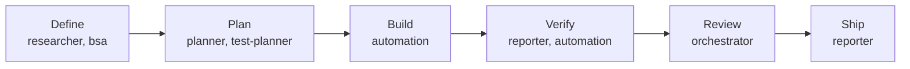

# Capability graph

<!-- GENERATED by `npm run build:graph` from prompts/agents, skills/ and the tool registry. Do not edit. -->

10 agents · 37 skills · 79 tools. A skill "mentions" a tool when its text names it in backticks; that is evidence of use, not proof, so every finding below is either fixed or accepted with a written reason in `docs/graph-baseline.json`, which may only shrink.

## Lifecycle and handoffs

```mermaid
flowchart LR
  a_planner(["planner"])
  a_orchestrator(["orchestrator"])
  a_researcher(["researcher"])
  a_test_planner(["test-planner"])
  a_automation(["automation"])
  a_reporter(["reporter"])
  a_documenter(["documenter"])
  a_bsa(["bsa"])
  a_importer(["importer"])
  a_self_improve(["self-improve"])
  a_planner -.-> a_orchestrator
  a_orchestrator -.-> a_automation
  a_orchestrator -.-> a_planner
  a_orchestrator -.-> a_reporter
  a_orchestrator -.-> a_researcher
  a_orchestrator -.-> a_test_planner
  a_researcher -.-> a_test_planner
  a_test_planner -.-> a_automation
  a_test_planner -.-> a_researcher
  a_automation -.-> a_reporter
  a_automation -.-> a_test_planner
  a_reporter -.-> a_automation
  a_reporter -.-> a_self_improve
  a_documenter -.-> a_planner
  a_documenter -.-> a_self_improve
  a_bsa -.-> a_reporter
  a_importer -.-> a_self_improve
```

## Agents, skills and tools

| Agent | Gateway tools | Skills | Hands off to |
|---|---|---|---|
| planner | 3 | `self-check`, `size-and-slice` | orchestrator |
| orchestrator | 4 | `adversarial-review`, `qe-program-coordination`, `review-delegated-work`, `route-to-specialist`, `self-check` | automation, planner, reporter, researcher, test-planner |
| researcher | 26 | `extract-requirements-from-image`, `extract-requirements-from-video`, `qe-meeting-notes`, `search-across-sources`, `self-check`, `structure-project-data` | test-planner |
| test-planner | 14 | `build-test-plan-interactive`, `qe-raci-coverage-matrix`, `qe-test-plan-builder`, `review-against-spec`, `self-check`, `test-design-techniques`, `upload-to-jtmf` | automation, researcher |
| automation | 13 | `code-review`, `detect-execution-convention`, `onboard-project`, `security-review`, `self-check`, `simplify`, `verify` | reporter, test-planner |
| reporter | 12 | `analyze-test-failures`, `data-visualization`, `qe-signoff-report`, `self-check`, `ship`, `update-jira-epic` | automation, self-improve |
| documenter | 15 | `consolidate-project-report`, `data-visualization`, `self-check` | planner, self-improve |
| bsa | 16 | `bulk-create-tickets`, `bulk-update-tickets`, `route-assignee`, `self-check`, `sprint-backlog-report` | reporter |
| importer | 1 | `self-check` | self-improve |
| self-improve | 4 | `build-capability`, `capture-correction`, `capture-learning`, `skillify` | — |

```mermaid
flowchart LR
  a_planner(["planner"])
  a_orchestrator(["orchestrator"])
  a_researcher(["researcher"])
  a_test_planner(["test-planner"])
  a_automation(["automation"])
  a_reporter(["reporter"])
  a_documenter(["documenter"])
  a_bsa(["bsa"])
  a_importer(["importer"])
  a_self_improve(["self-improve"])
  s_adversarial_review["adversarial-review"]
  s_analyze_test_failures["analyze-test-failures"]
  s_build_capability["build-capability"]
  s_build_test_plan_interactive["build-test-plan-interactive"]
  s_bulk_create_tickets["bulk-create-tickets"]
  s_bulk_update_tickets["bulk-update-tickets"]
  s_capture_correction["capture-correction"]
  s_capture_learning["capture-learning"]
  s_code_review["code-review"]
  s_consolidate_project_report["consolidate-project-report"]
  s_data_visualization["data-visualization"]
  s_detect_execution_convention["detect-execution-convention"]
  s_extract_requirements_from_image["extract-requirements-from-image"]
  s_extract_requirements_from_video["extract-requirements-from-video"]
  s_onboard_project["onboard-project"]
  s_qe_meeting_notes["qe-meeting-notes"]
  s_qe_program_coordination["qe-program-coordination"]
  s_qe_raci_coverage_matrix["qe-raci-coverage-matrix"]
  s_qe_signoff_report["qe-signoff-report"]
  s_qe_test_plan_builder["qe-test-plan-builder"]
  s_review_against_spec["review-against-spec"]
  s_review_delegated_work["review-delegated-work"]
  s_route_assignee["route-assignee"]
  s_route_to_specialist["route-to-specialist"]
  s_search_across_sources["search-across-sources"]
  s_security_review["security-review"]
  s_self_check["self-check"]
  s_ship["ship"]
  s_simplify["simplify"]
  s_size_and_slice["size-and-slice"]
  s_skillify["skillify"]
  s_sprint_backlog_report["sprint-backlog-report"]
  s_structure_project_data["structure-project-data"]
  s_test_design_techniques["test-design-techniques"]
  s_update_jira_epic["update-jira-epic"]
  s_upload_to_jtmf["upload-to-jtmf"]
  s_verify["verify"]
  a_planner --> s_self_check
  a_planner --> s_size_and_slice
  a_orchestrator --> s_adversarial_review
  a_orchestrator --> s_qe_program_coordination
  a_orchestrator --> s_review_delegated_work
  a_orchestrator --> s_route_to_specialist
  a_orchestrator --> s_self_check
  a_researcher --> s_extract_requirements_from_image
  a_researcher --> s_extract_requirements_from_video
  a_researcher --> s_qe_meeting_notes
  a_researcher --> s_search_across_sources
  a_researcher --> s_self_check
  a_researcher --> s_structure_project_data
  a_test_planner --> s_build_test_plan_interactive
  a_test_planner --> s_qe_raci_coverage_matrix
  a_test_planner --> s_qe_test_plan_builder
  a_test_planner --> s_review_against_spec
  a_test_planner --> s_self_check
  a_test_planner --> s_test_design_techniques
  a_test_planner --> s_upload_to_jtmf
  a_automation --> s_code_review
  a_automation --> s_detect_execution_convention
  a_automation --> s_onboard_project
  a_automation --> s_security_review
  a_automation --> s_self_check
  a_automation --> s_simplify
  a_automation --> s_verify
  a_reporter --> s_analyze_test_failures
  a_reporter --> s_data_visualization
  a_reporter --> s_qe_signoff_report
  a_reporter --> s_self_check
  a_reporter --> s_ship
  a_reporter --> s_update_jira_epic
  a_documenter --> s_consolidate_project_report
  a_documenter --> s_data_visualization
  a_documenter --> s_self_check
  a_bsa --> s_bulk_create_tickets
  a_bsa --> s_bulk_update_tickets
  a_bsa --> s_route_assignee
  a_bsa --> s_self_check
  a_bsa --> s_sprint_backlog_report
  a_importer --> s_self_check
  a_self_improve --> s_build_capability
  a_self_improve --> s_capture_correction
  a_self_improve --> s_capture_learning
  a_self_improve --> s_skillify
```

## Findings

| Kind | Finding | Status |
|---|---|---|
| skill-tool-gap | skill `capture-learning` (owner self-improve) names `jira_get_boards`, which self-improve does not hold | accepted: illustrative: the skill uses it as an example of a value to parameterize, not a step it performs |
| skill-tool-gap | skill `search-across-sources` (owner researcher) names `confluence_save_page`, which researcher does not hold | accepted: intentional: ask-before-save tools write to disk; the researcher is read-only, so the skill hands a confirmed save to an agent that holds the tool |
| skill-tool-gap | skill `search-across-sources` (owner researcher) names `github_save_file`, which researcher does not hold | accepted: intentional: ask-before-save tools write to disk; the researcher is read-only, so the skill hands a confirmed save to an agent that holds the tool |
| skill-tool-gap | skill `search-across-sources` (owner researcher) names `jira_save_issue`, which researcher does not hold | accepted: intentional: ask-before-save tools write to disk; the researcher is read-only, so the skill hands a confirmed save to an agent that holds the tool |
| skill-tool-gap | skill `sprint-backlog-report` (owner bsa) names `jira_move_to_sprint`, which bsa does not hold | accepted: intentional: the skill says never to call it during a routine report |
| unheld-tool | tool `confluence_add_comment` (confluence) is held by no agent | accepted: not needed yet: no skill or agent flow uses it; grant it to the owning agent, with an eval, when one does |
| unheld-tool | tool `confluence_delete_page` (confluence) is held by no agent | accepted: intentional: the framework never deletes; no agent is granted a delete tool |
| unheld-tool | tool `confluence_get_attachments` (confluence) is held by no agent | accepted: not needed yet: no skill or agent flow uses it; grant it to the owning agent, with an eval, when one does |
| unheld-tool | tool `confluence_get_comments` (confluence) is held by no agent | accepted: not needed yet: no skill or agent flow uses it; grant it to the owning agent, with an eval, when one does |
| unheld-tool | tool `confluence_save_page` (confluence) is held by no agent | accepted: intentional: ask-before-save pull-to-disk write (hard rule 12 confirms the folder); no agent is granted it until a flow needs it |
| unheld-tool | tool `get_file_metadata` (media) is held by no agent | accepted: not needed yet: no skill or agent flow uses it; grant it to the owning agent, with an eval, when one does |
| unheld-tool | tool `github_save_file` (github) is held by no agent | accepted: intentional: ask-before-save pull-to-disk write (hard rule 12 confirms the folder); no agent is granted it until a flow needs it |
| unheld-tool | tool `jira_move_to_sprint` (jira) is held by no agent | accepted: intentional: sprint moves are a manual decision; no agent is granted it |
| unheld-tool | tool `jira_save_issue` (jira) is held by no agent | accepted: intentional: ask-before-save pull-to-disk write (hard rule 12 confirms the folder); no agent is granted it until a flow needs it |
| unheld-tool | tool `jtmf_delete_test_case` (jtmf) is held by no agent | accepted: intentional: the framework never deletes; no agent is granted a delete tool |
| unheld-tool | tool `jtmf_get_test_plan` (jtmf) is held by no agent | accepted: not needed yet: no skill or agent flow uses it; grant it to the owning agent, with an eval, when one does |
| unheld-tool | tool `jtmf_raw_get` (jtmf) is held by no agent | accepted: intentional: raw escape hatch; agents use the typed JTMF tools |
| unheld-tool | tool `list_files` (artifacts) is held by no agent | accepted: not needed yet: no skill or agent flow uses it; grant it to the owning agent, with an eval, when one does |
| unheld-tool | tool `media_extract_requirements` (media) is held by no agent | accepted: intentional: batch tool driven by scripts/batch-media-extract.ts; agents use the single-file extraction tools |
| unheld-tool | tool `notify_email` (notify) is held by no agent | accepted: intentional: outbound messages need an explicit user ask; no agent flow sends them yet |
| unheld-tool | tool `notify_teams` (notify) is held by no agent | accepted: intentional: outbound messages need an explicit user ask; no agent flow sends them yet |

## Tools by server

| Server | Tools (held by) |
|---|---|
| allure-report | `allure_summary`, `generate_report`, `get_result_json`, `recording_summary` |
| artifacts | `consensus_score`, `knowledge_append`, `knowledge_search`, `list_files` (unheld), `read_repo_file` |
| codegen | `detect_conventions`, `scaffold_feature`, `scaffold_page`, `scaffold_step` |
| confluence | `confluence_add_comment` (unheld), `confluence_create_page`, `confluence_delete_page` (unheld), `confluence_download_attachment`, `confluence_extract_links`, `confluence_get_attachments` (unheld), `confluence_get_children`, `confluence_get_comments` (unheld), `confluence_get_page`, `confluence_save_page` (unheld), `confluence_search`, `confluence_update_page`, `confluence_upload_attachment` |
| git | `git_branches`, `git_diff`, `git_log`, `git_search`, `git_show` |
| github | `github_get_file`, `github_save_file` (unheld), `github_search_code`, `github_search_commits`, `github_search_issues`, `github_search_repos`, `github_search_topics` |
| jira | `jira_add_comment`, `jira_assign_issue`, `jira_bulk_create_issues`, `jira_bulk_update_issues`, `jira_create_issue`, `jira_get_backlog`, `jira_get_boards`, `jira_get_epic_children`, `jira_get_issue`, `jira_get_sprint_report`, `jira_get_sprints`, `jira_move_to_sprint` (unheld), `jira_save_issue` (unheld), `jira_search`, `jira_search_users`, `jira_transition_issue`, `jira_update_issue` |
| jtmf | `jtmf_create_test_case`, `jtmf_delete_test_case` (unheld), `jtmf_get_test_case`, `jtmf_get_test_plan` (unheld), `jtmf_raw_get` (unheld), `jtmf_search_tests`, `jtmf_update_test_case` |
| media | `create_diagram`, `create_docx`, `create_pdf`, `get_file_metadata` (unheld), `media_extract_requirements` (unheld), `ocr_image`, `ocr_pdf`, `read_csv_rows`, `read_diagram`, `read_docx_text`, `read_excel_rows`, `read_pdf_text` |
| notify | `notify_email` (unheld), `notify_teams` (unheld) |
| playwright-runner | `get_test_files`, `run_bdd`, `run_playwright` |
